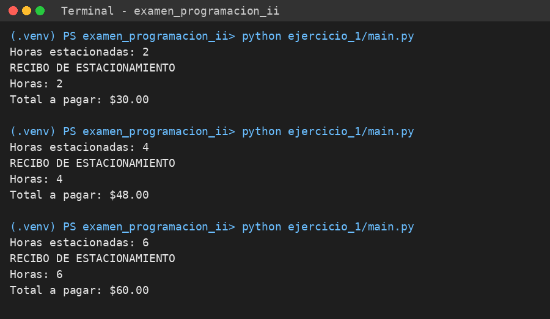
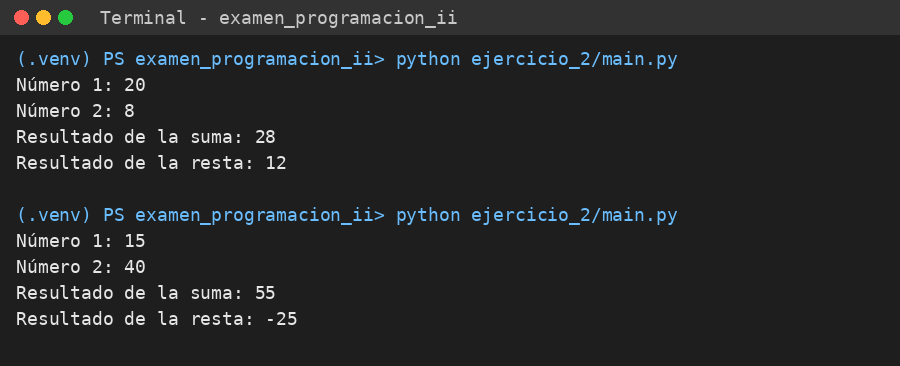

# Examen de Programación II - POO con Python

**Alumna:** Sara García
**Materia:** Programación II - Universidad Iberoamericana León
**Examen:** Tercer Examen Parcial

## Descripción

Proyecto que aplica los conceptos de Programación Orientada a Objetos en Python:
clases, propiedades, métodos, `__init__`, `self`, creación de objetos, llamadas a
métodos y herencia simple.

## Estructura

```
examen_programacion_ii/
├── examen/
│   └── preguntas.py      # Parte 1: preguntas respondidas y código completado
├── ejercicio_1/
│   └── main.py           # Parte 2: clase Estacionamiento
├── ejercicio_2/
│   └── main.py           # Parte 3: herencia con Operacion y Resta
├── evidencias/
│   ├── ejercicio1.png
│   └── ejercicio2.png
├── README.md
├── requirements.txt
└── .gitignore
```

## Contenido

- **Parte 1 (`examen/preguntas.py`):** respuestas como comentarios sobre la clase
  `Producto`, la clase `Rectangulo` completada (área de 8 × 5 = 40) e interpretación
  de la herencia entre `Operacion` y `Multiplicacion`.
- **Parte 2 (`ejercicio_1/main.py`):** clase `Estacionamiento` que calcula el cobro
  según las horas: 1 a 2 horas a $15.00, 3 a 5 horas a $12.00 y más de 5 horas a
  $10.00 por hora. Valida que las horas sean un entero mayor que cero.
- **Parte 3 (`ejercicio_2/main.py`):** clase padre `Operacion` (suma) y clase hija
  `Resta`, que hereda el constructor y redefine `calcular()`.

## Cómo ejecutar

1. Crear y activar el entorno virtual:

   ```
   python -m venv .venv
   .venv\Scripts\activate        # Windows
   source .venv/bin/activate     # macOS / Linux
   ```

2. Instalar dependencias (el proyecto solo usa la biblioteca estándar):

   ```
   pip install -r requirements.txt
   ```

3. Ejecutar cada parte desde la carpeta del proyecto:

   ```
   python examen/preguntas.py
   python ejercicio_1/main.py
   python ejercicio_2/main.py
   ```

## Evidencias

| Ejercicio | Casos probados | Captura |
|---|---|---|
| Estacionamiento | 2, 4 y 6 horas ($30.00, $48.00, $60.00) | `evidencias/ejercicio1.png` |
| Calculadora | 20 y 8 (28 y 12); 15 y 40 (55 y -25) | `evidencias/ejercicio2.png` |




